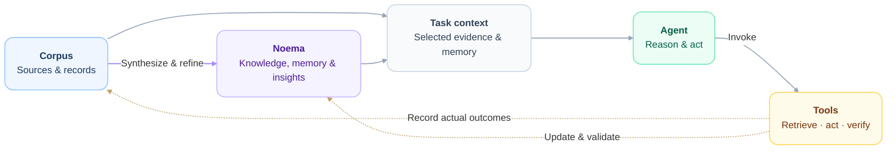

# Noema

An AI-native personal system for knowledge, memory, and action.

## Design

| Component | Purpose |
| --- | --- |
| [Corpus](corpus/README.md) | Sources and personal records. |
| [Tools](tools/README.md) | Shared capabilities for humans and agents. |
| [Noema](noema/README.md) | Evidence-linked memory, insights, and task context. |

Agents [recall](tools/noema/skills/noema-recall/SKILL.md) task context and [consolidate](tools/noema/skills/noema-consolidate/SKILL.md) durable outcomes through `context`, `record`, and `check`.

Initialize source checkouts with `git submodule update --init`; initialize nested submodules when needed.

[Agent instructions](AGENTS.md)
